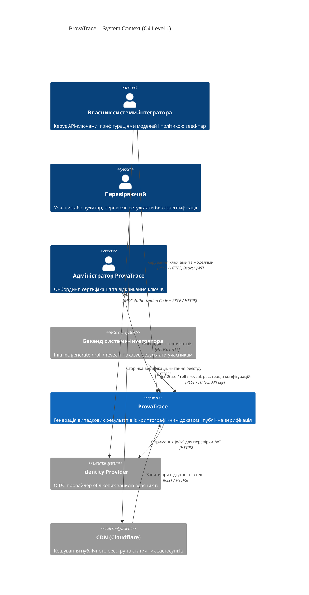

# РОЗДІЛ 2. ПРОЄКТУВАННЯ АРХІТЕКТУРИ СИСТЕМИ

Архітектуру змодельовано за методологією C4 Model (рівні Context, Container, Component) у форматі Diagrams-as-Code (Mermaid.js). Кожен елемент схем трасується до вимог специфікації [srs.md](srs.md); ключові технологічні рішення обґрунтовано в [adr/](adr/).

---

## 2.1 Контекстне та контейнерне моделювання системи (C4 Model)

### 2.1.1 Рівень 1. System Context

**Опис елементів**

| Елемент | Тип | Роль | Протокол взаємодії | Трасування |
|---|---|---|---|---|
| ProvaTrace | System | Формує результати операцій, підписує їх, веде публічний реєстр | – | [SRS 1.2](srs.md#12-межі-системи-scope) |
| Бекенд системи-інтегратора | System_Ext | Викликає життєвий цикл seed-пар і генерацію результатів | REST / HTTPS, API-ключ у заголовку | [SRS-FUN-08](srs.md#srs-fun-08), [SRS-FUN-11](srs.md#srs-fun-11), [SRS-FUN-23](srs.md#srs-fun-23) |
| Власник системи-інтегратора | Person | Працює в кабінеті | OIDC (Authorization Code + PKCE), Bearer JWT | [SRS-NFR-SEC-03](srs.md#srs-nfr-sec-03) |
| Перевіряючий | Person | Перевіряє операції без облікового запису | HTTPS через CDN | [SRS-FUN-19](srs.md#srs-fun-19), [SRS-FUN-22](srs.md#srs-fun-22) |
| Адміністратор ProvaTrace | Person | Онбординг і сертифікація ключів | HTTPS з mTLS у внутрішній мережі | [SRS-FUN-02](srs.md#srs-fun-02), [SRS-FUN-03](srs.md#srs-fun-03) |
| Identity Provider | System_Ext | Видає JWT власникам, публікує JWKS | OIDC / HTTPS | [SRS-NFR-SEC-03](srs.md#srs-nfr-sec-03) |
| CDN | System_Ext | Віддає кешовані незмінні дані реєстру | HTTPS | [SRS-NFR-PERF-02](srs.md#srs-nfr-perf-02) |

### 2.1.2 Рівень 2. Container Diagram

```mermaid
C4Container
    title ProvaTrace – Container Diagram (C4 Level 2)

    Person(owner, "Власник системи-інтегратора")
    Person(verifier, "Перевіряючий")
    Person(admin, "Адміністратор ProvaTrace")
    System_Ext(integrator, "Бекенд системи-інтегратора")
    System_Ext(idp, "Identity Provider", "OIDC")
    System_Ext(cdn, "CDN", "Cloudflare")

    Container_Boundary(pt, "ProvaTrace") {
        Container(verifierApp, "Verifier Web App", "TypeScript SPA", "Виконує ланцюжок перевірок у браузері з вбудованим root public key")
        Container(console, "Owner Console", "TypeScript SPA", "Кабінет власника системи-інтегратора")
        Container(gateway, "API Gateway", "nginx", "TLS 1.3 termination, rate limiting за IP, proxy_cache, маршрутизація")
        Container(core, "Core API", "Node.js, NestJS", "generate / roll / reveal, конфігурації моделей, реєстр, /verify")
        Container(onb, "Onboarding Service", "Node.js, NestJS", "Генерація, сертифікація та відкликання ключів підпису")
        ContainerDb(pg, "PostgreSQL Primary", "PostgreSQL 16", "Seed-пари, операції, конфігурації моделей, сертифікати")
        ContainerDb(pgr, "PostgreSQL Replica", "PostgreSQL 16", "Читання реєстру, резерв для failover")
        ContainerDb(redis, "Redis", "Redis 7", "Лічильники rate limiting на API-ключ")
        Container(vault, "Vault", "HashiCorp Vault, Transit, Raft", "Ключі Ed25519 і AES-256-GCM; sign / encrypt / decrypt")
        Container(obs, "Observability Stack", "Prometheus, Grafana, Jaeger", "Метрики, трасування, тривоги")
    }

    Rel(integrator, gateway, "API-виклики", "REST / HTTPS (TLS 1.3), API key")
    Rel(verifier, cdn, "Завантаження SPA і даних", "HTTPS")
    Rel(cdn, verifierApp, "Статичні файли SPA", "HTTPS")
    Rel(verifierApp, cdn, "Читання реєстру", "REST / HTTPS, JSON")
    Rel(cdn, gateway, "Запити при відсутності в кеші", "REST / HTTPS")
    Rel(owner, console, "Робота в кабінеті", "HTTPS")
    Rel(console, idp, "Вхід", "OIDC Authorization Code + PKCE / HTTPS")
    Rel(console, gateway, "Керування ключами та моделями", "REST / HTTPS, Bearer JWT")
    Rel(admin, onb, "Онбординг", "HTTPS, mTLS")
    Rel(gateway, core, "Проксіювання запитів", "REST / HTTP, внутрішня мережа")
    Rel(core, idp, "JWKS", "HTTPS")
    Rel(core, pg, "Транзакції, SELECT … FOR UPDATE", "SQL / TCP 5432, TLS")
    Rel(core, pgr, "Читання реєстру", "SQL / TCP 5432, TLS")
    Rel(pg, pgr, "Потокова реплікація", "PostgreSQL streaming replication / TCP")
    Rel(core, redis, "INCR / EXPIRE лічильників", "RESP / TCP 6379")
    Rel(core, vault, "sign, encrypt, decrypt", "REST / HTTPS (TLS 1.3), AppRole")
    Rel(onb, vault, "Створення ключів, підпис root-ключем", "REST / HTTPS (TLS 1.3), AppRole")
    Rel(onb, pg, "Запис CertifiedKey", "SQL / TCP 5432, TLS")
    Rel(obs, core, "Збір метрик", "Prometheus scrape / HTTP /metrics")
    Rel(core, obs, "Трасування", "OTLP / gRPC")

    UpdateLayoutConfig($c4ShapeInRow="4", $c4BoundaryInRow="1")
```

**Опис контейнерів**

| Контейнер | Технологія | Відповідальність | Трасування |
|---|---|---|---|
| Verifier Web App | TypeScript SPA, статичні файли через CDN | Незалежна перевірка в браузері; root public key вбудовано в код | [SRS-FUN-22](srs.md#srs-fun-22) |
| Owner Console | TypeScript SPA | Кабінет власника: API-ключі, моделі, політика seed-пар | [SRS-NFR-SEC-03](srs.md#srs-nfr-sec-03) |
| API Gateway | nginx | Єдина точка входу: TLS 1.3, ліміт запитів за IP, кешування відповідей реєстру | [SRS-NFR-SEC-01](srs.md#srs-nfr-sec-01), [SRS-NFR-SEC-05](srs.md#srs-nfr-sec-05), [SRS-NFR-PERF-02](srs.md#srs-nfr-perf-02) |
| Core API | Node.js, NestJS | Життєвий цикл seed-пар, генерація результатів, конфігурації моделей, реєстр, верифікація | [SRS-FUN-04](srs.md#srs-fun-04) … [SRS-FUN-21](srs.md#srs-fun-21), [SRS-FUN-23](srs.md#srs-fun-23) … [SRS-FUN-25](srs.md#srs-fun-25) |
| Onboarding Service | Node.js, NestJS | Єдиний контейнер з доступом до root-ключа | [SRS-FUN-01](srs.md#srs-fun-01) … [SRS-FUN-03](srs.md#srs-fun-03), [SRS-NFR-SEC-04](srs.md#srs-nfr-sec-04) |
| PostgreSQL Primary / Replica | PostgreSQL 16 | Транзакційне сховище; репліка обслуговує читання реєстру і є резервом | [SRS-FUN-14](srs.md#srs-fun-14), [SRS-NFR-REL-04](srs.md#srs-nfr-rel-04) |
| Redis | Redis 7 | Спільні лічильники ліміту запитів для всіх реплік Core API | [SRS-NFR-SEC-05](srs.md#srs-nfr-sec-05) |
| Vault | HashiCorp Vault (Transit, Raft) | Ключі та криптографічні операції без видачі ключів застосунку | [SRS-FUN-01](srs.md#srs-fun-01), [SRS-FUN-09](srs.md#srs-fun-09), [SRS-FUN-13](srs.md#srs-fun-13), [ADR-001](adr/0001-choice-of-technology.md) |
| Observability Stack | Prometheus, Grafana, Jaeger | Метрики RED, трасування, тривоги | [SRS-NFR-OBS-01](srs.md#srs-nfr-obs-01) |

**Протоколи взаємодії.** Зовнішній трафік проходить лише через API Gateway по HTTPS (TLS 1.3). Усередині периметра Core API звертається до PostgreSQL по SQL / TCP з TLS, до Redis по RESP / TCP, до Vault по REST / HTTPS з автентифікацією AppRole. Метрики збираються Prometheus за моделлю pull, траси надсилаються за протоколом OTLP / gRPC.

**Розділення Core API та Onboarding Service.** Кореневий ключ доступний лише Onboarding Service через окрему політику Vault; Core API, що обробляє публічний трафік, не має прав на операції з цим ключем ([SRS-NFR-SEC-04](srs.md#srs-nfr-sec-04)). Компрометація Core API не дає змоги сертифікувати сторонній ключ.

**Відсутність брокера повідомлень.** Генерація результату синхронна за моделлю довіри: система-інтегратор очікує підписаний результат у відповіді на запит. Асинхронних потоків на критичному шляху немає, тому брокер повідомлень не вводиться.

---

## 2.2 Компонентне моделювання критичного сервісу системи (Core API)

Для декомпозиції обрано контейнер **Core API**: він виконує всі криптографічні обчислення на критичному шляху, транзакційну обробку операцій і ланцюжок верифікації.

```mermaid
C4Component
    title Core API (NestJS) – Component Diagram (C4 Level 3)

    Container(gateway, "API Gateway", "nginx")
    ContainerDb(pg, "PostgreSQL Primary", "PostgreSQL 16")
    ContainerDb(pgr, "PostgreSQL Replica", "PostgreSQL 16")
    ContainerDb(redis, "Redis", "Redis 7")
    Container(vault, "Vault", "HashiCorp Vault Transit")
    System_Ext(idp, "Identity Provider", "OIDC")

    Container_Boundary(core, "Core API") {
        Component(pipeline, "Request Pipeline", "NestJS Middleware, Interceptors", "Correlation ID, структуроване логування, метрики RED, OpenTelemetry spans")
        Component(apiKeyGuard, "ApiKeyGuard", "NestJS Guard", "Перевірка API-ключа, визначення platformId")
        Component(jwtGuard, "JwtAuthGuard, RolesGuard", "NestJS Guard", "Перевірка JWT за JWKS, RBAC для кабінету")
        Component(throttler, "ThrottlerGuard", "NestJS Guard, Redis storage", "Ліміт запитів на API-ключ")
        Component(validation, "ValidationPipe", "class-validator DTO", "Валідація тіла запиту і формату client_seed")
        Component(errors, "GlobalExceptionFilter", "NestJS ExceptionFilter", "Перетворення доменних помилок на HTTP-коди")

        Component(seedCtl, "SeedPairController", "REST controller", "POST /generate, POST /reveal")
        Component(rollCtl, "RollController", "REST controller", "POST /roll")
        Component(modelCtl, "ModelConfigController", "REST controller", "POST /models")
        Component(registryCtl, "RegistryController", "REST controller", "GET /plays, /seed-pairs, /models, /keys")
        Component(verifyCtl, "VerifyController", "REST controller", "GET /verify")

        Component(seedSvc, "SeedPairService", "Application service", "Створення та розкриття seed-пар")
        Component(rollSvc, "RollService", "Application service", "Оркестрація транзакції roll")
        Component(modelSvc, "ModelConfigService", "Application service", "Валідація, комітмент, версіонування моделей")
        Component(registrySvc, "RegistryQueryService", "Application service", "Читання публічного реєстру")
        Component(verifySvc, "VerificationService", "Application service", "Ланцюжок дев'яти перевірок")

        Component(engine, "FairnessEngine", "Domain service", "HMAC-SHA256 і rejection sampling")
        Component(adapters, "AdapterRegistry", "Domain, Strategy pattern", "Адаптери моделей: Case, Dice, Coinflip, Roulette")
        Component(canon, "Canonicalizer", "Domain, RFC 8785", "Канонізація та SHA-256 payload")
        Component(ports, "Ports", "TypeScript interfaces", "SigningPort, SeedCipherPort, UnitOfWork, Repository-інтерфейси")

        Component(vaultAdapter, "VaultTransitAdapter", "node-vault", "Реалізує SigningPort і SeedCipherPort, таймаут 2 с")
        Component(pgAdapter, "PostgresUnitOfWork, Repositories", "TypeORM QueryRunner", "Транзакції, SELECT … FOR UPDATE")
        Component(readAdapter, "RegistryReadRepository", "TypeORM", "Запити лише на читання до репліки")
    }

    Rel(gateway, pipeline, "HTTP-запит", "REST / HTTP")
    Rel(pipeline, apiKeyGuard, "Маршрути інтегратора", "NestJS lifecycle")
    Rel(pipeline, jwtGuard, "Маршрути кабінету", "NestJS lifecycle")
    Rel(pipeline, registryCtl, "Публічні маршрути", "NestJS lifecycle")
    Rel(pipeline, verifyCtl, "Публічні маршрути", "NestJS lifecycle")
    Rel(apiKeyGuard, throttler, "Наступний guard", "NestJS lifecycle")
    Rel(throttler, redis, "INCR / EXPIRE", "RESP / TCP")
    Rel(jwtGuard, idp, "JWKS", "HTTPS")
    Rel(throttler, validation, "Запит до DTO", "NestJS lifecycle")
    Rel(jwtGuard, validation, "Запит до DTO", "NestJS lifecycle")
    Rel(validation, rollCtl, "Валідований DTO", "Method call")
    Rel(validation, seedCtl, "Валідований DTO", "Method call")
    Rel(validation, modelCtl, "Валідований DTO", "Method call")

    Rel(rollCtl, rollSvc, "Виклик use case", "DI, constructor injection")
    Rel(seedCtl, seedSvc, "Виклик use case", "DI, constructor injection")
    Rel(modelCtl, modelSvc, "Виклик use case", "DI, constructor injection")
    Rel(registryCtl, registrySvc, "Виклик use case", "DI, constructor injection")
    Rel(verifyCtl, verifySvc, "Виклик use case", "DI, constructor injection")
    Rel(rollCtl, errors, "Доменні винятки", "NestJS exception layer")

    Rel(rollSvc, engine, "Обчислення числа", "Method call")
    Rel(rollSvc, adapters, "Інтерпретація числа", "Strategy")
    Rel(rollSvc, canon, "Хеш payload", "Method call")
    Rel(rollSvc, ports, "Транзакція, підпис, розшифрування", "Interface call, DIP")
    Rel(seedSvc, ports, "Транзакція, шифрування, підпис", "Interface call, DIP")
    Rel(modelSvc, adapters, "Валідація конфігурації", "Strategy")
    Rel(modelSvc, canon, "Хеш конфігурації", "Method call")
    Rel(modelSvc, ports, "Збереження, підпис", "Interface call, DIP")
    Rel(registrySvc, ports, "Читання реєстру", "Interface call, DIP")
    Rel(verifySvc, engine, "Перерахунок результату", "Method call")
    Rel(verifySvc, adapters, "Перевірка відображення", "Strategy")
    Rel(verifySvc, canon, "Перевірка хешів", "Method call")
    Rel(verifySvc, ports, "Читання даних", "Interface call, DIP")

    Rel(vaultAdapter, ports, "implements", "Dependency Inversion")
    Rel(pgAdapter, ports, "implements", "Dependency Inversion")
    Rel(readAdapter, ports, "implements", "Dependency Inversion")
    Rel(vaultAdapter, vault, "sign, encrypt, decrypt", "REST / HTTPS, AppRole")
    Rel(pgAdapter, pg, "Транзакції", "SQL / TCP 5432")
    Rel(readAdapter, pgr, "SELECT", "SQL / TCP 5432")

    UpdateLayoutConfig($c4ShapeInRow="4", $c4BoundaryInRow="1")
```

**Шари та залежності.** Схема відповідає принципам Clean Architecture: залежності спрямовані всередину, від вхідного шару до доменного ядра.

| Шар | Компоненти | Правило залежності |
|---|---|---|
| Вхідний (Inbound) | Request Pipeline, Guards, ValidationPipe, Controllers, GlobalExceptionFilter | Контролери викликають лише application-сервіси; доступу до репозиторіїв і Vault не мають |
| Застосунку (Application) | SeedPairService, RollService, ModelConfigService, RegistryQueryService, VerificationService | Оркеструють use case; працюють з інфраструктурою лише через інтерфейси Ports |
| Домену (Domain) | FairnessEngine, AdapterRegistry, Canonicalizer, Ports | Чисті функції без залежностей від NestJS, БД і мережі |
| Інфраструктури (Outbound) | VaultTransitAdapter, PostgresUnitOfWork, RegistryReadRepository | Реалізують інтерфейси Ports (Dependency Inversion) і підставляються через DI-контейнер NestJS |

**Опис компонентів**

| Компонент | Роль | Взаємодія | Трасування |
|---|---|---|---|
| Request Pipeline | Correlation ID, логування без секретів, метрики RED, спани OpenTelemetry | NestJS Middleware та Interceptors | [SRS-NFR-OBS-01](srs.md#srs-nfr-obs-01), [SRS-NFR-SEC-07](srs.md#srs-nfr-sec-07) |
| ApiKeyGuard | Перевіряє SHA-256 хеш API-ключа, встановлює `platformId` у контекст запиту | NestJS Guard | [SRS-FUN-23](srs.md#srs-fun-23), [SRS-NFR-SEC-02](srs.md#srs-nfr-sec-02) |
| JwtAuthGuard, RolesGuard | Перевіряють JWT за JWKS Identity Provider і роль користувача кабінету | NestJS Guard | [SRS-NFR-SEC-03](srs.md#srs-nfr-sec-03) |
| ThrottlerGuard | Ліміт запитів на API-ключ зі спільними лічильниками в Redis | NestJS Guard, RESP / TCP | [SRS-NFR-SEC-05](srs.md#srs-nfr-sec-05) |
| ValidationPipe | Валідує DTO; невалідні запити отримують `400` до виконання бізнес-логіки | class-validator | [SRS-FUN-04](srs.md#srs-fun-04) |
| GlobalExceptionFilter | Перетворює доменні помилки (`NONCE_MISMATCH`, `SEED_PAIR_CLOSED`, `VAULT_UNAVAILABLE`) на HTTP-коди без розкриття внутрішніх деталей | NestJS ExceptionFilter | [SRS-NFR-REL-03](srs.md#srs-nfr-rel-03) |
| RollService | Відкриває транзакцію через UnitOfWork, блокує seed-пару, викликає FairnessEngine, адаптер, Canonicalizer, SigningPort, зберігає операцію | DI, інтерфейси Ports | [SRS-FUN-11](srs.md#srs-fun-11) … [SRS-FUN-16](srs.md#srs-fun-16) |
| SeedPairService | Створює seed-пару, шифрує seed, розкриває пару з `RevealRecord` | DI, інтерфейси Ports | [SRS-FUN-08](srs.md#srs-fun-08) … [SRS-FUN-10](srs.md#srs-fun-10), [SRS-FUN-17](srs.md#srs-fun-17), [SRS-FUN-18](srs.md#srs-fun-18) |
| ModelConfigService | Валідує, канонізує, підписує й версіонує конфігурації | DI, Strategy | [SRS-FUN-04](srs.md#srs-fun-04) … [SRS-FUN-07](srs.md#srs-fun-07) |
| RegistryQueryService | Надає дані реєстру лише на читання | DI, інтерфейси Ports | [SRS-FUN-19](srs.md#srs-fun-19) |
| VerificationService | Виконує ланцюжок перевірок тим самим доменним кодом, що й генерація | DI | [SRS-FUN-20](srs.md#srs-fun-20), [SRS-FUN-21](srs.md#srs-fun-21) |
| FairnessEngine | HMAC-SHA256 і rejection sampling | Чиста функція | [SRS-FUN-11](srs.md#srs-fun-11), [SRS-NFR-COR-01](srs.md#srs-nfr-cor-01) |
| AdapterRegistry | Вибір адаптера за типом моделі (Strategy) | Чиста функція | [SRS-FUN-12](srs.md#srs-fun-12) |
| Canonicalizer | RFC 8785 і SHA-256 | Чиста функція | [SRS-FUN-06](srs.md#srs-fun-06), [SRS-FUN-13](srs.md#srs-fun-13) |
| VaultTransitAdapter | Реалізує `SigningPort` і `SeedCipherPort` через Vault Transit, таймаут 2 с | REST / HTTPS, AppRole | [SRS-FUN-09](srs.md#srs-fun-09), [SRS-FUN-13](srs.md#srs-fun-13), [ADR-001](adr/0001-choice-of-technology.md) |
| PostgresUnitOfWork, Repositories | Транзакції з `SELECT … FOR UPDATE`, `lock_timeout`, обмеження `UNIQUE(seedPairId, nonce)` | SQL / TCP | [SRS-FUN-14](srs.md#srs-fun-14), [SRS-NFR-REL-02](srs.md#srs-nfr-rel-02) |
| RegistryReadRepository | Запити до репліки PostgreSQL | SQL / TCP | [SRS-NFR-PERF-02](srs.md#srs-nfr-perf-02) |

**Інверсія залежностей.** RollService не знає про Vault і TypeORM: він залежить від інтерфейсів `SigningPort`, `SeedCipherPort` та `UnitOfWork`. Конкретні реалізації реєструються в модулі NestJS як провайдери (`{ provide: SIGNING_PORT, useClass: VaultTransitAdapter }`). Це дозволяє тестувати доменне ядро з in-memory реалізаціями портів і замінити сховище ключів без змін бізнес-логіки ([ADR-001](adr/0001-choice-of-technology.md), наслідки).

---

## 2.3 Документування архітектурних рішень (Architecture Decision Records)

| ADR | Рішення | Статус |
|---|---|---|
| [ADR-001](adr/0001-choice-of-technology.md) | HashiCorp Vault (Transit Secrets Engine) як сховище ключів і виконавець криптографічних операцій | Approved |
